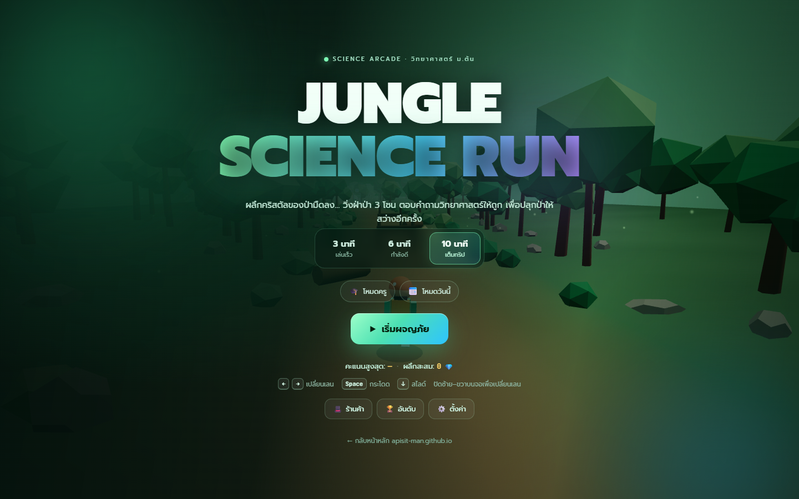
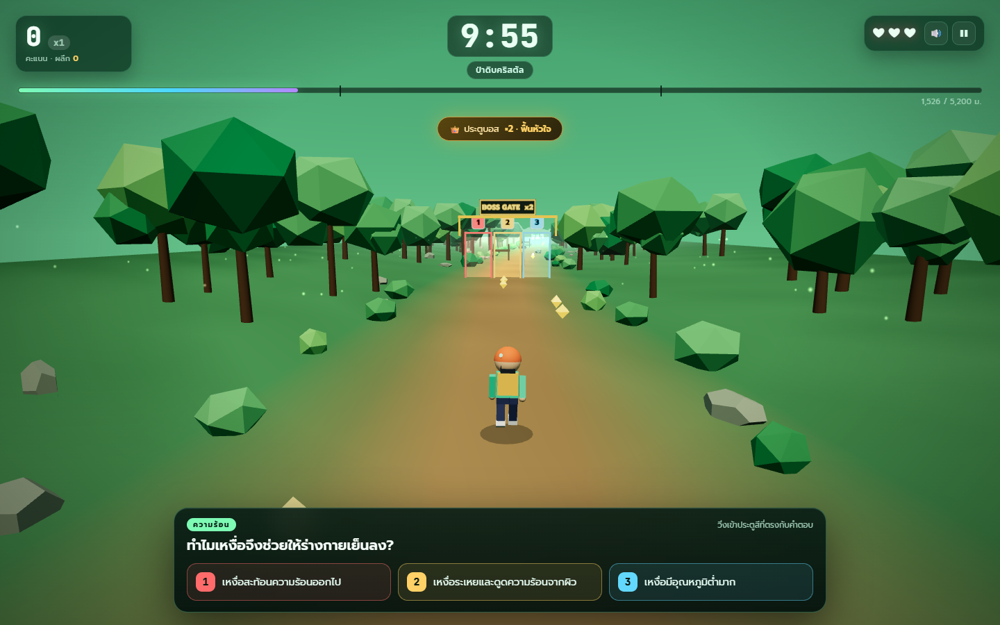
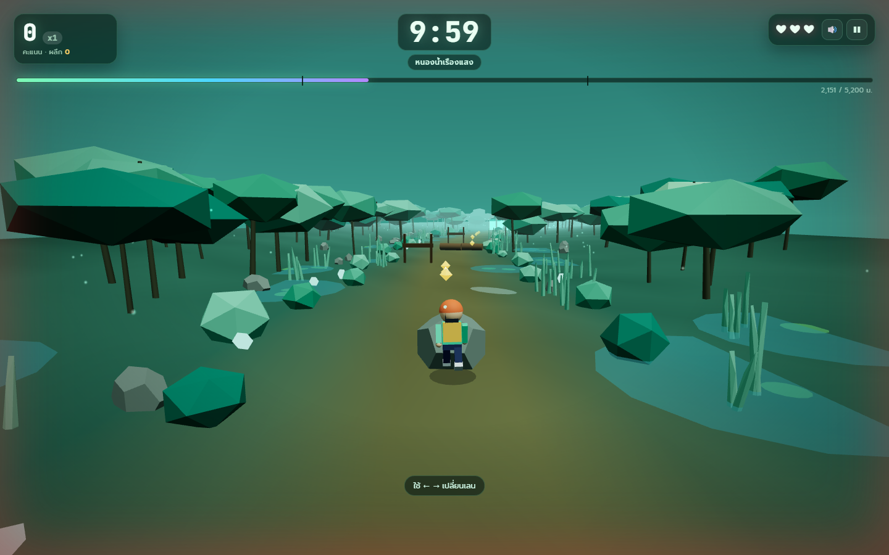
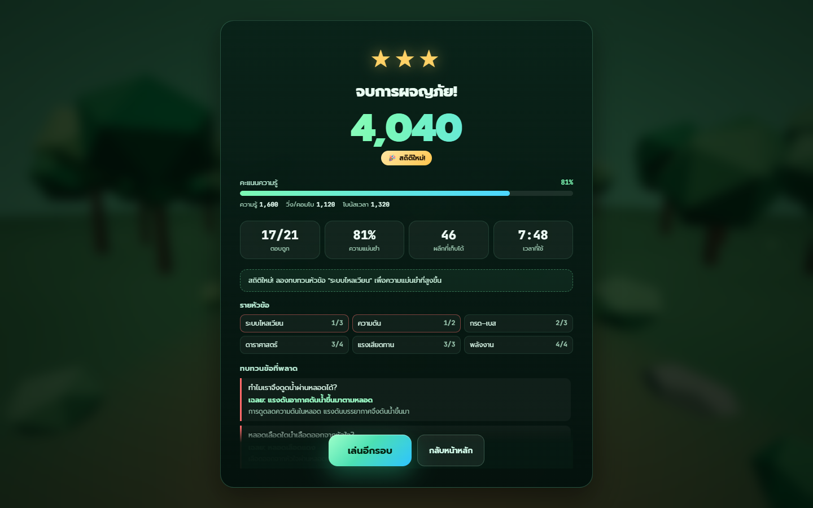

# 🌿 Jungle Science Run — วิ่งผจญภัยป่าวิทยาศาสตร์ 3D (v2)

เกมวิ่ง 3 มิติสำหรับนักเรียน **ม.ต้น** ผสมระบบคำถามวิทยาศาสตร์เข้ากับการวิ่งเก็บของ
เนื้อหาวิทยาศาสตร์พื้นฐานที่เจอได้ในชีวิตประจำวัน **78 ข้อ** ผ่านป่า 3 โซน
มีโหมด **3 / 6 / 10 นาที**, โหมดครู, ประตูบอส, ร้านค้าปลดล็อกหมวก และอันดับคะแนน

| | |
| --- | --- |
|  |  |
|  |  |

## มีอะไรใหม่ใน v2

- **ระบบนำเข้าชุดคำถามกำหนดเองผ่านไฟล์ CSV (Custom Questions CSV)**: ให้ครูหรือผู้เล่นป้อนข้อสอบของตนเองผ่านไฟล์ `.csv` (Excel / Google Sheets) หรือพิมพ์วางข้อความ พร้อมระบบพรีวิวตรวจสอบความถูกต้อง และดาวน์โหลดไฟล์ตัวอย่าง UTF-8 BOM
- **ระบบอ่านออกเสียงโจทย์ (Web Speech API TTS ภาษาไทย)**: อ่านคำถามวิทยาศาสตร์อัตโนมัติเมื่อเข้าใกล้ประตู พร้อมปุ่ม "ฟังโจทย์" ซ้ำได้ทุกเมื่อ และเปิด/ปิดได้ในหน้าตั้งค่า
- **เสียงลมปะทะความเร็ว (Procedural Aerodynamic Wind Noise)**: สังเคราะห์เสียงลมหวีดตามระดับความเร็วด้วย Web Audio API แบบ Pure Synthesizer
- **ระบบควบคุมมือถือ Dual-Thumb สมบูรณ์แบบ**: รองรับทั้งแนวตั้งและแนวนอน (Landscape Safe-Area Layout) พร้อมปุ่มเต็มหน้าจอสากล 4 มุม (Fullscreen API)
- **สอดคล้องกับมาตรฐานเว็บไซต์ส่วนตัว ดร.อภิสิทธิ์ ธงไชย**: อิสระทางวิชาการ (Independent Learning Lab), ไม่มีสถาบันต้นสังกัดในแบรนดิ้ง, Schema.org WebApplication Metadata สมบูรณ์
- **ทางเดินปลอดอุปสรรคก่อนถึงประตูคำถาม 62 ม.** — ไม่โดนของที่มองไม่เห็นระหว่างอ่านคำถาม
- **คะแนนแยกเป็น "ความรู้" และ "วิ่ง"** พร้อมฐานะรายหัวข้อท้ายรอบ (ครูใช้ดูจุดอ่อนได้)
- **ประตูบอสท้ายโซน ×2 คะแนน และฟื้นหัวใจ 1 ดวง** เมื่อตอบถูก
- **โซนเคลียร์** ขึ้นสรุประหว่างเปลี่ยนโซน
- **โหมด 3 / 6 / 10 นาที**, **โหมดครู** (ไม่เสียหัวใจ ไม่หมดเวลา), **โหมดวันนี้** (คำถามชุดเดียวกันทั้งวัน)
- **ผลึกเป็นเงินตรา** ปลดล็อกหมวก/เป้ 5 สกิน
- **ระบบสัมผัสที่ดีขึ้น**: input buffer 160 ms, hit-stop ตอนชน, near-miss +10, เสียงฝีเท้า, อุปสรรคเต้นเตือนล่วงหน้า
- **ตั้งค่า**: ขนาดตัวอักษร, ลดการเคลื่อนไหว, เปิด-ปิดเสียง, ส่งออกข้อมูลการเล่น (JSON)
- คลังคำถามขยายจาก 36 → **78 ข้อ** ตัวเลือกสั้นลง (อ่านทันใน 6 วินาที)

## วิธีเล่น

| การกระทำ | คีย์บอร์ด | มือถือ |
| --- | --- | --- |
| เปลี่ยนเลน | `←` `→` หรือ `A` `D` | ปัดซ้าย–ขวา หรือปุ่ม ◀ ▶ |
| กระโดด (ข้ามขอนไม้/แอ่งน้ำ) | `Space` / `↑` | ปัดขึ้น หรือปุ่ม ▲ |
| สไลด์ (ลอดกิ่งไม้) | `↓` | ปัดลง หรือปุ่ม ▼ |
| พักเกม | `Esc` / `P` | ปุ่ม ❚❚ |

**กติกาคะแนน**

- ตอบถูก: **+100 คะแนนความรู้** (บอส ×2) + **โบนัสคอมโบ** `(คอมโบ−1) × 50` (สูงสุด x5) + ต่อเวลา 5 วิ (บอส 10 วิ)
- ตอบผิด: −50 คะแนนวิ่ง, −8 วินาที, หัวใจ −1, คอมโบรีเซ็ต
- เก็บผลึก: **+25 คะแนนวิ่ง** และเข้ากระเป๋าไว้ซื้อสกิน
- ผ่านอุปสรรคเลนข้างแบบหวุดหวิด: **+10**
- ชนขอนไม้/โขดหิน/กิ่งไม้: หัวใจ −1 และหยุดชั่วขณะ (hit-stop)
- จบรอบเมื่อวิ่งครบระยะทาง (ได้โบนัสเวลาที่เหลือ ×10), หมดเวลา หรือหัวใจหมด
- ดาว 1–3 ดวง: 3 ดาว = ตอบถูก ≥ 80% และเหลือหัวใจ ≥ 2

## ไฟล์ในโปรเจกต์

```
index.html          หน้าเกม + HUD + เมนู/ร้านค้า/อันดับ/ตั้งค่า + หน้าสรุป
css/style.css       ธีม UI ทั้งหมด (รองรับมือถือ/แนวนอน/ตัวอักษรใหญ่)
js/main.js          เกมลูป, โหมด, คะแนน, บอส, โซนเคลียร์, บันทึกสถิติ
js/world.js         โลก procedural 3 โซน + ประตูบอส + ทางเดินปลอดภัย
js/path.js          เส้นทาง Catmull-Rom สร้างต่อเนื่อง
js/player.js        ตัวละคร + สกิน + แอนิเมชันวิ่ง/กระโดด/สไลด์
js/questions.js     คลังคำถาม 78 ข้อ (26/โซน) + เฉลย + หมวดหมู่
js/csv.js           ระบบนำเข้า/ส่งออกและประมวลผลไฟล์ CSV แม่แบบ
js/tts.js           ระบบอ่านออกเสียงคำถามภาษาไทย (Web Speech API)
js/ui.js            จัดการ DOM/HUD/หน้าจอทั้งหมด
js/audio.js         เสียงสังเคราะห์ WebAudio (รวมเสียงฝีเท้า/near-miss/บอส)
js/config.js        โหมดความยาว, โซน, สกิน, ค่าปรับสมดุลเกม
vendor/             Three.js r185 (module + core) — ไม่พึ่ง CDN
start-jungle-run.bat  เปิดพรีวิวในเครื่อง (python http.server :8787)
```

## เปิดเล่นในเครื่อง

ดับเบิลคลิก `start-jungle-run.bat` แล้วเปิด http://localhost:8787/

```powershell
cd "personal website/applications/jungle-science-run"
python -m http.server 8787
```

> ต้องเสิร์ฟผ่าน HTTP (ไม่ใช่เปิดไฟล์ `index.html` ตรง ๆ) เพราะเกมใช้ ES Module + import map

## สำหรับครู

- **โหมดครู**: ไม่เสียหัวใจ และไม่จบเกมเมื่อหมดเวลา — เหมาะกับกิจกรรมหน้าชั้น
- **โหมดวันนี้**: ทุกเครื่องได้คำถามและเส้นทางชุดเดียวกันทั้งวัน เหมาะกับการแข่งในห้อง
- **หน้าสรุป** แสดงความแม่นยำรายหัวข้อ เพื่อดูว่าควรทบทวนเรื่องใดต่อ
- **ส่งออกข้อมูลการเล่น** (JSON) ในหน้าตั้งค่า เพื่อนำไปวิเคราะห์คะแนนรายข้อ

## เทคนิค

- Three.js r185 (vendored), WebGL, ไม่มี build step — static site ล้วน
- โลกป่า procedural จาก seed ใหม่ทุกรอบ (หรือ seed ตามวันในโหมดวันนี้)
- `InstancedMesh` รวมต้นไม้/หิน/หญ้าเป็นชุดต่อ chunk + stream chunk ตามระยะผู้เล่น
- โดมท้องฟ้าไล่สี + fog ปรับตามโซน, ไม่มี post-processing
- ชะลอเวลา (slow-motion) อัตโนมัติเมื่อเข้าใกล้ประตูคำถาม
- เก็บสถิติใน `localStorage`: คะแนนสูงสุด, ผลึก, สกิน, อันดับ 30 รายการ, telemetry 400 รายการ

## อันดับคะแนนห้องเรียน (ไม่บังคับ)

ค่าเริ่มต้นอันดับจะเก็บในเครื่องผู้เล่น (`localStorage`) ถ้าต้องการให้ทั้งห้องเห็นอันดับร่วมกัน
ให้กำหนด `window.JSR_CLOUD` ก่อนโหลด `main.js` (เช่นใน `index.html`):

```html
<script>
  window.JSR_CLOUD = {
    submitUrl: 'https://script.google.com/macros/s/XXXX/exec',      // รับ POST JSON
    boardUrl:  'https://script.google.com/macros/s/XXXX/exec?board=1', // คืน JSON array
    game: 'jungle-science-run',
  };
</script>
```

- ตัวรับฝั่งเซิร์ฟเวอร์ต้องตอบ `Access-Control-Allow-Origin: *` และคืน JSON
- รองรับ Google Apps Script Web App, Firebase Realtime Database REST, Cloudflare Worker ฯลฯ
- ถ้าไม่ตั้งค่า แท็บ "อันดับห้องเรียน" จะซ่อนโดยอัตโนมัติ

## ข้อควรรู้

- ต้องเปิดผ่าน http/https เท่านั้น
- ฟอนต์ Prompt/Sarabun โหลดจาก Google Fonts (ถ้าออฟไลน์จะใช้ฟอนต์ระบบแทน)
- ระบบเสียงเริ่มทำงานหลังผู้เล่นกดเริ่มเกม (ข้อจำกัดของเบราว์เซอร์)
- อันดับคะแนนเก็บในเครื่องนี้เป็นค่าเริ่มต้น และเชื่อมอันดับห้องเรียนได้ผ่าน `window.JSR_CLOUD`
